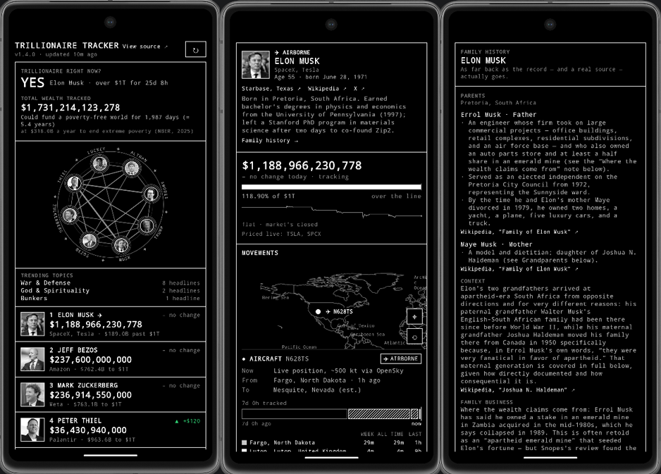

# Trillionaire Tracker

An Android app, built with Kotlin and Jetpack Compose, that tracks the net worth, aircraft and yacht movements, news coverage and backgrounds of eight people: Elon Musk, Jeff Bezos, Mark Zuckerberg, Peter Thiel, Dario Amodei, Donald Trump, Palmer Luckey and Sam Altman. A scheduled Python worker gathers the data from public sources and publishes it as a single static file.

**[Download the latest APK](https://github.com/Hostu404/TrillionaireTracker/releases/latest)**



## Features

- **Net worth**: shares at live market prices, plus private stakes at their last funding-round valuation, plus cash, minus liabilities. Share counts come from SEC filings, and non-USD holdings are converted at a live exchange rate. Each figure shows how it is made and when its estimated parts were last checked.
- **Aircraft**: flight state, departure, arrival and the airports visited in the last 7 days, from free ADS-B feeds with automatic fallback between sources. Locations are kept at airport level; a live position is shown only while a plane is airborne and is never stored.
- **Yachts**: the same for vessels, from AIS data, at port level.
- **News**: each person's latest headlines from Google News. An optional Gemini call sorts them into seven tracked themes (Alien News, Bunkers, Underground, Antichrist, Apocalypse, God & Spirituality, War & Defense), with an all-time count per person and the most common current themes on the main page.
- **Connections**: a circular diagram of what the eight share in their backgrounds (upbringing, schooling, family origins and formative influences), each fact sourced. Business and politics are excluded.
- **Biography and family history**: birth date, city-level residence, a short sourced biography, a Wikipedia summary with a freely licensed photo, and a sourced family history.

## How it works

```
worker (every 5 min) → snapshot.json → GitHub Pages → app
```

A worker on GitHub Actions polls public sources, writes `snapshot.json` and publishes it through GitHub Pages. The app only reads that file, so load on the upstream sources does not grow with the number of users. The app ships with a seed snapshot and runs without a backend.

## Running it

**App:** open the project in Android Studio and run it on a device or emulator (minSdk 26). It starts on the seed data.

**Backend:**

```bash
cd backend
cp holdings.example.json holdings.json   # fill in from SEC filings
python3 snapshot_worker.py               # writes snapshot.json
```

Python standard library only. To publish it, follow [Going live](DESIGN.md#going-live) and set `Config.SNAPSHOT_URL` to the published file. Vessel tracking needs a free `AISSTREAM_API_KEY`, and news themes need `GEMINI_API_KEY` and `GEMINI_NEWS_MODEL`. Both are optional.

## Limitations

- Everything shown comes from public records: SEC filings, ADS-B and AIS broadcasts, Wikipedia and news feeds. The app is only as accurate as those sources and shows nothing beyond them.
- Private stakes and other estimated figures are updated by hand and dated in the app.
- Zuckerberg's share count is derived from a reported stake percentage and needs periodic re-checking.
- Changing the news theme list resets every all-time theme count.

Design notes, data sources and further limitations: [DESIGN.md](DESIGN.md).

## License

MIT. See [LICENSE](LICENSE).
